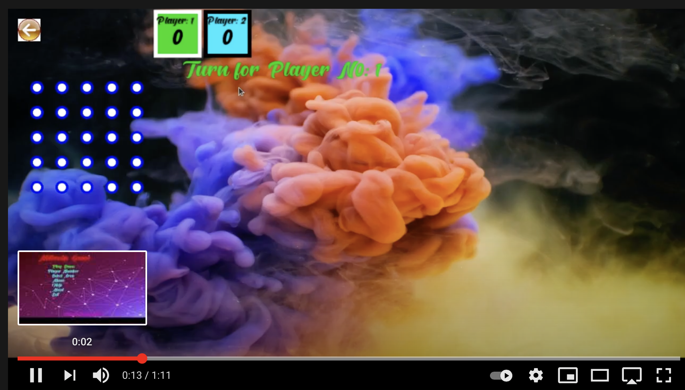

# Millantis
Es un juego de puzzles local para múltiples jugadores

<ul>
 

   <h2>Reglas</h2>
 <li>1.Cada jugador tiene un solo turno para trazar una línea entre dos puntos. </li>
 <li>2.Si un jugador puede formar un cuadrado, obtendrá un punto y deberá trazar la siguiente línea. </li>
  <li>3.El jugador con más cuadrados ganará la partida. </li>
   

   <li>Para reiniciar una partida, vuelve a seleccionar el área</li>

   </ul>
    

    

  <h4>Configuración del sistema</h4>
  <ul>
    <li>Lenguaje: C++</li>
    <li>Biblioteca: SFML (Multiplataforma)</li>
    <li>Funciona en: Linux | Windows</li>
  </ul>
  
 

 
 

  <h1>Guía de instalación para Linux</h1>
  <ol>
    <li>git clone https://github.com/Abdullahfoysal/Millantis_Game.git | Descarga el .zip desde latest@Release</li>
   <li>Extrae el archivo .zip</li>
   <li>Ve a la carpeta Millantis_master</li>
   <li>Abre la terminal en ese directorio</li>
   <li>En la terminal escribe:  <b>./app-run</b> </li>
  
    
  </ol>
  
 

 
  

  <h1>Guía de instalación para Windows</h1>
  <ol>
    <li>git clone https://github.com/Abdullahfoysal/Millantis_Game.git | Descarga el .zip desde latest@Release</li>
   <li>Extrae el archivo .zip</li>
   <li>Ve a la carpeta Millantis_master</li>
   <li>Haz doble clic en:  <b>millantis.exe</b> </li>
    
  </ol>
  
 

